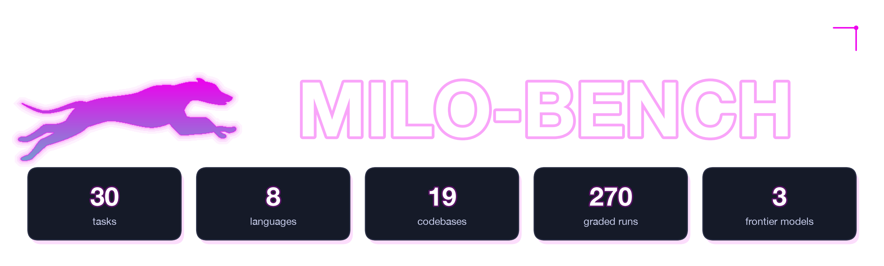
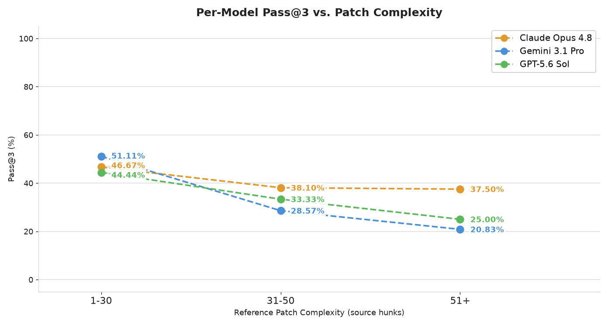
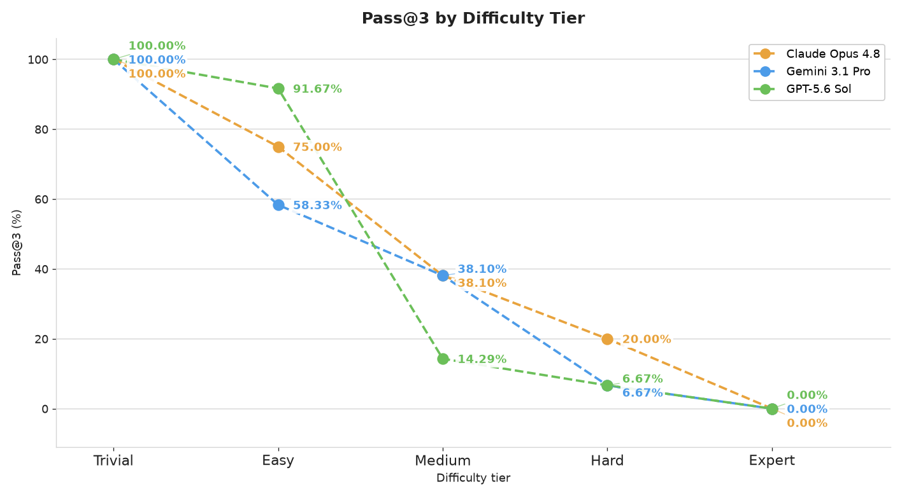
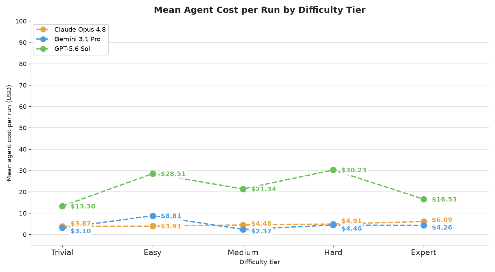
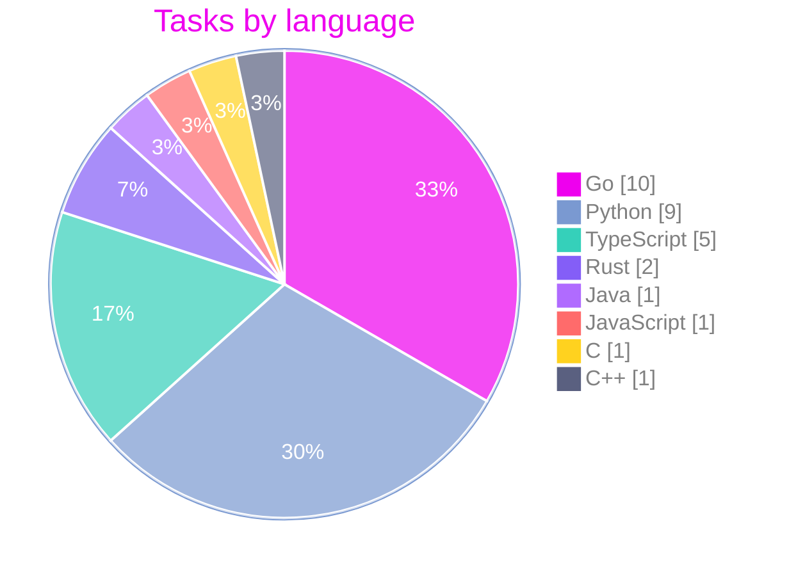
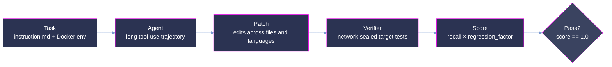

<p align="center">
  
</p>

<p align="center">
  <strong>Measuring long-horizon software-engineering competence at the granularity of milestones.</strong>
</p>

<p align="center">
  <a href="#summary"></a>
  <a href="#scoring-methodology"></a>
  <a href="#scoring-methodology"></a>
  <a href="#verification-and-quality-assurance"></a>
</p>

<p align="center"><sub>
  <a href="#summary">Summary</a> · <a href="#repository-layout">Layout</a> · <a href="#difficulty-tiers">Tiers</a> · <a href="#results-pass-rate-vs-reference-patch-complexity">Results</a> · <a href="#analysis">Analysis</a> · <a href="#coverage">Coverage</a> · <a href="#dataset-structure">Dataset</a> · <a href="#trajectory-structure">Trajectories</a> · <a href="#scoring-methodology">Scoring</a> · <a href="#how-runs-are-verified">Verifier</a> · <a href="#reproduction">Reproduction</a> · <a href="#verification-and-quality-assurance">Verification</a>
</sub></p>

# Milo-Bench: 30-Task Evaluation Sample

**Milo-Bench measures long-horizon software-engineering capability, not just isolated coding ability.**
It evaluates whether an agent can complete milestone-scale engineering tasks that span multiple
files, languages, and architectural components while keeping an existing production codebase correct,
not the individual functions or short bug fixes that narrower benchmarks target. Where SWE-bench and
Multi-SWE-bench score single-issue fixes, Milo-Bench targets whole milestones resolved across a
codebase over a long agent trajectory.

This is a curated **30-task** sample from Milo-Bench. Each task is a self-contained, containerized
issue-resolution problem, paired with the complete agent trajectories of three frontier models
(Claude Opus 4.8, Gemini 3.1 Pro, and GPT-5.6 Sol) at 3 runs per model, for 270 graded runs in
total, each scored by the Milo-Bench verifier.

Tasks are grouped into five difficulty tiers (Trivial, Easy, Medium, Hard, Expert),
calibrated from observed difficulty on this sample, and cover 8 languages across 19 codebases.

Each model's pass rate declines as reference-patch scope (`src_hunks`) grows. See
[Results](#results-pass-rate-vs-reference-patch-complexity) for how `src_hunks` is defined.



> **This is a representative, quality-controlled sample of the full Milo-Bench corpus,** provided
> for evaluation. The dataset format, trajectory format, and scoring are identical to the
> production benchmark.

## Summary

| Property            | Value                                                                              |
| :------------------ | :--------------------------------------------------------------------------------- |
| Tasks               | **30** (Trivial 6 / Easy 4 / Medium 7 / Hard 5 / Expert 8)                         |
| Difficulty tiers    | 5, by **observed difficulty**                                                      |
| Models evaluated    | Claude Opus 4.8, Gemini 3.1 Pro, GPT-5.6 Sol                                      |
| Runs & grid         | 3 per model (`run_1`/`run_2`/`run_3`) = 9 per task, 270 total; full 3 × 3, no gaps |
| Score               | continuous score in [0, 1] (partial credit), per run in `result.json`              |
| Languages           | 8 (Go, Python, TypeScript, Rust, Java, JavaScript, C, C++)                         |
| Codebases           | 19                                                                                 |

**Pass rates on this sample** (see [Scoring methodology](#scoring-methodology) for how pass@3 is
defined):

| Metric                     | Value |
| :------------------------- | ----: |
| Claude Opus 4.8 **pass@3** | 42.2% |
| Gemini 3.1 Pro **pass@3**  | 37.8% |
| GPT-5.6 Sol **pass@3**     | 36.7% |

## Repository layout

```
milo-bench-samples/
├── README.md                 # this document
├── LICENSE                   # MIT
├── images/                   # figures
│   ├── hero.png
│   ├── pass_rate.png
│   ├── pass_rate_by_tier.png
│   └── cost_by_tier.png
└── <uuid>/                   # one self-contained directory per task UUID (30)
    ├── task.toml, instruction.md, environment/, solution/, tests/, TRUTH.md
    └── trajectories/         # the runs for that task
        └── <model>/run_N/ ...   # model ∈ {opus-4.8, gemini-3.1-pro-preview, gpt-5.6-sol}
```

Each task is one directory holding everything about it: the problem, the reference solution, the
grading material, and every run recorded against it. Under `trajectories/` all three models appear
as `<model>/` directories, each containing exactly three `run_N/` samples, so every task directory
holds 9 runs and the sample holds 270.

## Difficulty tiers

The 30 tasks are stratified into five tiers by observed difficulty on this sample: how consistently
the three models solve each task across its runs. Trivial tasks are solved by every run; Expert
tasks by none. This is an **outcome-based** stratification, computed from the runs shipped here, so
the tiers describe what the models actually experienced rather than any property fixed in advance.
Each task's tier is recorded in `<uuid>/task.toml` under `[metadata].difficulty`.



| Tier        |   n | mean score |
| :---------- | --: | ---------: |
| **Trivial** |   6 |      1.000 |
| **Easy**    |   4 |      0.806 |
| **Medium**  |   7 |      0.519 |
| **Hard**    |   5 |      0.300 |
| **Expert**  |   8 |      0.336 |

## Results: pass rate vs reference-patch complexity

`src_hunks` is the number of independent source edit sites in the reference patch
(`solution/fix.patch`). It is a property of the human reference solution, computed before any model
runs. Tier (pass rate) and `src_hunks` (reference-patch scope) are correlated but distinct: pass
rate falls as patch complexity rises (the figure at the top of this document), but a small patch can
still be Hard and a large one Easy. Difficulty here reflects what the models experienced, not patch
size.

Per-task figures are derivable directly from the shipped files: `src_hunks` from
`<uuid>/task.toml` (`[metadata].src_hunks`) and per-run scores from
`<uuid>/trajectories/<model>/run_N/result.json` (and `verifier/score.md`). The complexity
figure groups the 30 tasks into three bins by `src_hunks`: **1 to 30** (15 tasks), **31 to 50** (7) and
**51+** (8, ranging up to 802 edit sites). `src_hunks` is heavily right-skewed on this sample
(half the tasks sit at 30 edit sites or below, while the three largest reference patches are 745,
770 and 802), so the top bin is open-ended to keep a workable number of tasks in each.

Scope is a real but **weak** predictor of success here (Spearman ρ ≈ −0.31 between `src_hunks` and
a task's solve rate). Pass rate trends down as patch scope grows, but a small patch can still be
very hard: two tasks with reference patches of just 7 and 9 edit sites went unsolved by every model.
Read the figure as a tendency, not a law.

**Per-tier pass@3 by model** (fraction of each model's runs in the tier that fully solved the task,
score = 1.0):

| Tier (n)    | Claude Opus 4.8 | Gemini 3.1 Pro | GPT-5.6 Sol |
| :---------- | --------------: | -------------: | ----------: |
| Trivial (6) |          100.0% |         100.0% |      100.0% |
| Easy (4)    |           75.0% |          58.3% |       91.7% |
| Medium (7)  |           38.1% |          38.1% |       14.3% |
| Hard (5)    |           20.0% |           6.7% |        6.7% |
| Expert (8)  |            0.0% |           0.0% |        0.0% |

**Per-tier mean score by model** (mean continuous score across each model's runs in the tier,
partial credit in [0, 1]):

| Tier (n)    | Claude Opus 4.8 | Gemini 3.1 Pro | GPT-5.6 Sol |
| :---------- | --------------: | -------------: | ----------: |
| Trivial (6) |          100.0% |         100.0% |      100.0% |
| Easy (4)    |           83.3% |          62.5% |       95.8% |
| Medium (7)  |           62.8% |          42.6% |       50.4% |
| Hard (5)    |           48.5% |          20.0% |       21.4% |
| Expert (8)  |           48.7% |          23.4% |       28.8% |

With 30 tasks across five tiers, these are an average tendency on a small, curated sample rather
than a precise law. Note that mean score does **not** keep falling from Hard to Expert. It
flattens for Claude Opus 4.8 and rises slightly for the other two. Pass rate and partial credit
measure different things: a task that one model occasionally solves outright while the others score
near zero can average lower than a task nobody solves but everyone partially completes.

Inference cost does not track difficulty cleanly on this sample.



## Analysis

Milo-Bench brings together two directions earlier benchmarks pursued separately. Multi-SWE-bench
widened issue resolution from Python to seven more languages, but kept each task a single issue
closed by a single patch. SWE-EVO went the other way, raising the task to release-scale evolution
where agents that clear most of single-issue SWE-bench solve only about a quarter of the tasks, but
it stays Python-only. Milo-Bench is the one benchmark that does both at once: milestone-scale tasks
that span a codebase, across eight languages, scored on a continuous scale so partial progress on a
long task stays visible. Because these benchmarks use different task sets, the rates above are not
directly comparable to the pass rates reported here.

Pass rate captures how hard the tasks are, not how far apart the models are. Pass@3 never rises
from one tier to the next for any of the three models, but it flattens exactly where the models
differ most. Every model scores 0% on the Expert tier, so pass rate calls all three identical
there; by mean score, Claude Opus 4.8 completes 49% of an average Expert task, GPT-5.6 Sol 29%, and
Gemini 3.1 Pro 23%. The Hard tier shows the same compression (pass@3 of 20 / 7 / 7 against mean
scores of 49 / 20 / 21).

This happens because a run earns a pass only when every target test passes: one that resolves most
of a milestone-scale task but misses a single site scores the same zero as one that did nothing.
Mean score keeps crediting that partial progress, so it stays informative where pass rate bottoms
out, which is also why the two metrics stop agreeing on tier ordering at the bottom of the range.

The metric can flip the ranking. By per-model pass@3 the order is Claude Opus 4.8 (42.2%), Gemini
3.1 Pro (37.8%), GPT-5.6 Sol (36.7%); by mean score it is Claude Opus 4.8 (66.8%), GPT-5.6 Sol
(55.8%), Gemini 3.1 Pro (47.8%). Gemini and GPT trade places: GPT-5.6 Sol is last by pass@3 but
clearly ahead by mean score, because it often gets most of the way without landing the exact 1.0.
Claude Opus 4.8 leads on both metrics here, but a reader who took only the pass figures away would
still order the other two backwards.

Cost shows the efficiency-performance trade-off, and it is not a simple function of difficulty.
GPT-5.6 Sol is the priciest model at every tier by a wide margin, between roughly 3× and 9×
Claude Opus 4.8 or Gemini 3.1 Pro, but its per-tier cost is non-monotonic, peaking on Hard
($30.23) and falling to $16.53 on Expert, where runs more often terminate early without a workable
approach. Claude Opus 4.8 stays within a narrow $3.87 to $6.09 band across all five tiers, and
Gemini 3.1 Pro within $2.37 to $8.81. Claude Opus 4.8 is therefore the most cost-efficient of the
three: near the bottom of the cost range while leading both accuracy metrics.

These separations are trustworthy only because the scores cannot be gamed: grading is network-sealed,
and any run that reached for a task's reference solution or edited the graded tests was rejected
rather than scored. A model's standing reflects the task it solved, not an answer it found.

## Coverage

| Language   | Tasks |     | Language   | Tasks |
| :--------- | ----: | :-- | :--------- | ----: |
| Go         |    10 |     | Java       |     1 |
| Python     |     9 |     | JavaScript |     1 |
| TypeScript |     5 |     | C          |     1 |
| Rust       |     2 |     | C++        |     1 |

**19 codebases.** Most-represented: 99designs/gqlgen (4), Textualize/rich (4),
langchain-ai/langchain (4), clap-rs/clap (2), babel/babel (2); the remaining 14 contribute a single
task each. Each task bundles a milestone-scale change set (2 to 86 referenced PRs/issues, with
reference patches spanning 1 to 802 source edit sites).



## Dataset structure

Each task lives under `<uuid>/` at the repository root and is fully self-contained:

```
<uuid>/
├── task.toml                 # metadata (incl. [metadata].src_hunks), resource and network policy
├── instruction.md            # the prompt presented to the agent
├── TRUTH.md                  # what the milestone changes, and where the load-bearing work lands
├── environment/
│   └── Dockerfile            # builds the repository at its base commit
├── solution/
│   ├── fix.patch             # the reference ("oracle") source patch
│   └── solve.sh              # applies and commits the oracle patch
├── tests/
│   ├── config.json           # test transitions and the canonical test list
│   ├── run_tests.py          # the verifier entry point
│   ├── test.patch            # the grading tests, applied before scoring
│   ├── test.sh               # runs run_tests.py against config.json
│   ├── rubrics.json          # the graded item set for how the run was carried out
│   └── test_pytest.py        # deterministic process checks, generated from rubrics.json
└── trajectories/             # the runs recorded against this task
    └── <model>/run_N/ ...
```

`TRUTH.md` states, in prose, which issues the milestone bundles, how many files the reference
change touches, and which sites carry the load. It is written from the reference solution and is
never shown to the agent.

During a run the agent sees only the built repository, `instruction.md`, and the environment.
`solution/` and `tests/` are used exclusively by the verifier and are never exposed to the agent.
The **target** tests the agent must newly pass are the union of fail-to-pass, skip-to-pass, and
none-to-pass tests (`f2p ∪ s2p ∪ n2p`) from `tests/config.json`; the **preserve set** that must not
regress is the already-passing tests.

## Trajectory structure

Each run lives under `<uuid>/trajectories/<model>/run_N/`:

```
<uuid>/trajectories/<model>/run_N/   # model ∈ {opus-4.8, gemini-3.1-pro-preview, gpt-5.6-sol}; N ∈ {1,2,3}
├── result.json            # config, agent metrics, verifier score + diagnostics
├── config.json            # the run configuration
├── agent/
│   ├── trajectory.json     # structured step-by-step trace (steps[] with tool_calls + observations)
│   ├── recording.cast      # asciinema v2 terminal recording
│   └── <model>.pane        # terminal pane snapshot (opus.pane / gemini.pane / gpt.pane)
├── artifacts/manifest.json
└── verifier/
    ├── score.md            # the final score (single float)
    ├── test-stdout.md      # verifier test output
    ├── process.json        # every check and judge verdict behind the process channels
    ├── final_score.md     # the same run restated as a short readable table
    └── verdicts.jsonl      # append log of the judging, one line per judge per item plus retries
```

Key `result.json` fields: `verifier_result.scores.score` (continuous score ∈ [0, 1]),
`verifier_result.scores.score_binary` (strict all-or-nothing), `verifier_result.status`,
`verifier_result.diagnostics` (recall, regression factor, target/preserve counts), and
`agent_result` (token usage, `cost_usd`, episodes). The bare score is also in `verifier/score.md`.
The same block carries the process channels described in [How runs are
verified](#how-runs-are-verified): `score_outcome`, `score_deterministic`, `score_rubric`,
`score_process`, `score_eval` and `score_rl`, with the settings that produced them in
`verifier_result.assay`. The authoritative model id is `config.agent.model_name`
(`opus-4.8`, `gemini-3.1-pro-preview`, `gpt-5.6-sol`), and it matches the model directory
name on every run.

## Scoring methodology



The verifier computes a continuous score per run:

```
score = recall × regression_factor
```

- **Recall** = newly-passing target tests / effective targets (`f2p ∪ s2p ∪ n2p`, baseline-subtracted
  so only genuinely newly-passing tests count).
- **Regression factor** = `1 - penalty`, where the penalty scales preserve-set tests the patch breaks
  against a fixed denominator; it is 1.0 for the large majority of runs (score then equals recall).

A run solves a task only when its continuous score is exactly 1.0 (`score_binary = 1`).
Throughout this document, pass@3 is a run-level rate: a model's solved runs divided by its total
runs, not a per-task "at least one of 3 runs solved" metric. The verifier runs
network-sealed (`task.toml [verifier].network_mode = "none"`) so the reference solution cannot
influence a run.

Every task ships a human-authored reference patch at `solution/fix.patch` that passes all target
tests and scores 1.0 by construction: the target tests (`f2p ∪ s2p ∪ n2p`) are defined as the tests
this patch flips to passing. This guarantees the grading harness is self-consistent (each task has a
known-good solution under its own tests); it is **not** an independent measure of real-world
solvability.

## How runs are verified

The score above answers whether the patch works. Every run is also graded on **how it was
produced**, and both halves ship with the sample so either can be checked.

Each task carries a graded item set in `tests/rubrics.json`. The issue-coverage and scope-discipline
items are written from that task's own ground truth; the honesty, verification, adherence and
maintainability items are shared wording applied to every task, so runs stay comparable across the
sample. Two independent channels grade a run against that set:

- **Deterministic** (`tests/test_pytest.py`, generated from `rubrics.json`). Mechanical checks read
  off the trajectory: that the run and the bundle agree on identity and score, that no oracle path
  under `solution/` was read, that the graded tests were not rewritten, and that nothing was
  fetched from the task's own upstream repository. Some of these are hard gates.
- **Rubric.** A council of three judges (`anchor`, `second`, `third`) rates the judgement calls that
  no static check can settle, such as whether the run stayed in scope and reported its own work
  honestly. `verifier/verdicts.jsonl` is the append log of that judging: one line per judge per
  item, plus a line for every attempt that had to be retried, so some items appear more than once
  and a line may carry an `error` instead of a `completion`. `process.json` records the settled
  result and how far the judges agreed (`raw_agreement`, mean pairwise Cohen's `kappa`).

The two combine as `process = (deterministic + κ × rubric) / (1 + κ)`, where κ is the judges'
measured agreement on that run, so the rubric channel counts for as much as the council is
reliable. Outcome and process then combine into `score_eval` and `score_rl`, weighted so outcome
dominates and process can only break ties: the weight on process is at most 10%. A run that trips a
hard gate keeps its outcome score and its channel scores, but both scores are zeroed (`gate = 0`);
23 of the 270 runs are gated this way.

The gate is deliberately conservative and fires on the *attempt*, not on a success. Of those 23:
10 reached for their task's upstream repository and were refused at the egress layer, 9 are the
runs the verifier could not score, and 4 wrote to a graded test file and were caught by the
fix-patch guard. None of them obtained a reference solution; the refusals are in the trajectories.

The authoritative numbers for every channel are the `verifier_result.scores` fields in
`result.json`, with the settings that produced them in `verifier_result.assay`:

| field | meaning |
| :---------------------- | :------------------------------------------------------ |
| `score_outcome`         | the outcome channel, the same value as `score`            |
| `score_deterministic`   | the deterministic channel                                 |
| `score_rubric`          | the rubric channel                                        |
| `score_process`         | `(deterministic + κ × rubric) / (1 + κ)`; the exact κ is in `verifier_result.assay` |
| `score_eval`           | the composed score used for evaluation, absolute        |
| `score_rl`             | the composed score used for training, relative to the task's outcome stratum |

`verifier/final_score.md` restates the same run as a short table for reading, and
`verifier/process.json` holds every underlying check and judge verdict.

Nothing in this section feeds the pass rates or mean scores reported earlier. Those come from the
outcome channel alone, so the figures stay comparable to any harness that only runs the tests.

## Reproduction

Image-building, agent execution, and scoring are orchestrated by the **Milo-Bench harness**. The
score and full diagnostics for every run are in
`<uuid>/trajectories/<model>/run_N/result.json`,
with the bare score in `verifier/score.md`.

### Recompute the pass rates yourself

No trajectory re-execution is needed. Read the shipped scores directly:

```python
import json, glob, collections
def solved(run_dir):                      # a run "solves" iff score == 1.0
    r = json.load(open(f"{run_dir}/result.json"))
    return float(r["verifier_result"]["scores"]["score"]) == 1.0
# pass@3 per model = fraction of that model's runs that solved (score == 1.0)
by_model = collections.defaultdict(list)
for rd in glob.glob("*/trajectories/*/run_*"):
    by_model[rd.split("/")[2]].append(solved(rd))
for model, runs in sorted(by_model.items()):
    print(f"{model} pass@3 = {sum(runs) / len(runs):.3f}")
# -> opus-4.8 0.422 · gemini-3.1-pro-preview 0.378 · gpt-5.6-sol 0.367
```

`src_hunks` (used for the complexity axis of the figure) is recorded per task in
`<uuid>/task.toml` under `[metadata].src_hunks` and is reproducible directly from
`solution/fix.patch` (counted over hand-written source files only, excluding generated, test,
doc, and config files).

## Verification and quality assurance

This sample passed a QC gate prior to delivery:

- **Structure.** 30 dataset and 30 trajectory directories, matched 1:1 by UUID; required files
  present and non-empty in every task and every run; the full 3 × 3 grid (270 runs) is complete; the
  terminal-pane filename matches the model.
- **Score integrity.** Every score is read directly from a `result.json`; `verifier/score.md`
  agrees with `result.json` on every run; `config.agent.model_name` matches the model directory.
- **Reward-hacking resistance.** Every observed attempt to fetch a task's reference solution from its
  **own source repository** (the merged PR, raw blobs, the commit/diff endpoints) was refused at the
  egress layer, and the refusal is visible in the shipped trajectory: `Egress to task repo <org>/<repo>
  on api.github.com blocked by anti-reward-hacking policy`, with the PR and patch-diff endpoints
  blocked unconditionally. Attempts made through `urllib` come back as `HTTP 403`, and a run that
  tried to reach the same patch through a web archive got the archive's own page rather than the
  diff. **No run obtained its gold solution from the network.** The deterministic channel records
  each attempt, so this is checkable per run rather than asserted.
- **Fair play.** The agent is never given the reference solution (`solution/`) or the grading tests
  (`tests/`); these are mounted only for the verifier (`network_mode = "none"`).
- **No defective evals.** Every run is either verifier-`scored` or is a **legitimate model failure**
  (e.g., the model emitted an unapplyable patch, or edited graded test files and was blocked by the
  fix-patch guard). The sample contains **no infrastructure, environment, or reference-patch
  defects**: on every task the gold patch applies and the harness grades correctly, demonstrated by
  the runs that score on that same task. 24 of 30 tasks are fully scored across all 9 runs; the
  remaining 6 each contain one to three runs that legitimately failed for a model-side reason.
- **Limitations.**
  - **Sample size.** 30 tasks (4 to 8 per tier) with 3 runs per model; per-tier and per-language
    breakdowns are averages on small n with real run-to-run variance, not precise estimates. The
    Easy tier holds only 4 tasks, so its per-model points move in steps of about 8 percentage
    points and should not be read as stable estimates.
  - **Tier calibration.** Tiers are derived from observed outcomes on this sample, so they are not
    an independent, pre-registered measure of task difficulty.
  - **Contamination.** Tasks come from public codebases; whether any appeared in a model's training
    data is unknown, so pass rates are not a contamination-free measure of difficulty.
  - **Model nondeterminism.** The same model can produce different outputs for the same task, so a
    model's results vary somewhat from run to run.
